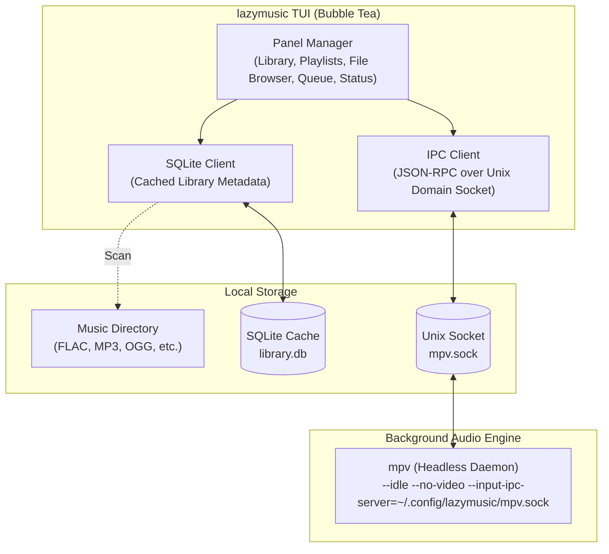

# Implementation Plan - lazymusic TUI

A `lazygit`-inspired terminal user interface for local music management and playback built with **Go** and **Charm's Bubble Tea**.

---

## 1. Goal Description

Build a fast, keyboard-driven terminal music player and library manager called `lazygit` for music (`lazymusic`). The application focuses strictly on local, offline audio files (MP3, FLAC, OGG, WAV, Opus) and provides an ergonomic multi-panel interface.

Key features:
- **`lazygit`-style Ergonomics**: Numbered panels (`1`-`3`, `0`), instant panel switching, fuzzy filtering (`/`), and accordion height expansion on focus.
- **Persistent Headless Playback**: Playback runs via an independent or detachable background `mpv` daemon through a local Unix socket (`~/.config/lazymusic/mpv.sock`). Quitting `lazymusic` leaves audio playing smoothly; relaunching reconnects and synchronizes playback state and queue.
- **Fast Local Library Engine**: Scans audio metadata, caches to SQLite (`~/.config/lazymusic/library.db`) for near-instant boot, with directory, artist, album, and track browsing.

---

## 2. Architecture & Daemon Model



### Background Playback Behavior
- On startup, `lazymusic` checks for an existing `mpv.sock`.
- If the socket exists and responds, `lazymusic` attaches immediately, querying the current file, playback time, pause status, and queue.
- If no socket exists, `lazymusic` spawns a detached background `mpv` process (`mpv --idle --no-terminal --input-ipc-server=<path>`) and connects to it.
- When quitting the TUI:
  - Default quit (`q`): Detaches from daemon; audio continues playing in background.
  - Hard stop & quit (`Q`): Sends `quit` command over IPC to stop `mpv`, deletes socket, and closes TUI.

---

## 3. Panel Layout & Navigation

### Layout Grid
- **Left Column**: Panels `1`, `2`, `3` stacked vertically with **dynamic accordion height** (the focused panel expands to ~60-70% height; inactive panels collapse to ~15-20%).
- **Right Column**: Panel `0` (Queue) takes the full height of the main window for full visibility of upcoming tracks.
- **Bottom Panel**: Consolidated Status & Now Playing (Playback controls, title, artist, album, audio format/bitrate, scrub bar, volume, status tickers).

```
┌─────────────────────────────────┬─────────────────────────────────────────────┐
│ 1: Library (Expanded on focus)  │ 0: Queue (Full right height)                │
│  [Dirs] [Artists] [Albums]      │  1. Airbag - Radiohead                      │
│   ▸ Radiohead                   │ >2. Paranoid Android - Radiohead            │
│  >▸ Pink Floyd                  │  3. Time - Pink Floyd                       │
│     ▸ The Dark Side of the Moon │  4. Money - Pink Floyd                      │
│     ▸ Wish You Were Here        │  5. Us and Them - Pink Floyd                │
│     ▸ Animals                   │  6. Brain Damage - Pink Floyd               │
│   ▸ Daft Punk                   │                                             │
├─────────────────────────────────┤                                             │
│ 2: Playlists (Collapsed)        │                                             │
│  >▸ Favorites                   │                                             │
├─────────────────────────────────┤                                             │
│ 3: File Browser (Collapsed)     │                                             │
│  ~/Music/                       │                                             │
├─────────────────────────────────┴─────────────────────────────────────────────┤
│ Status & Now Playing (Consolidated Info + Controls)                           │
│ [▶ Playing] Paranoid Android • Radiohead • OK Computer (1997)                 │
│ 03:12 ━━━━━━━━━━━━━━●──────────────────────── 06:23   FLAC 24-bit 96kHz       │
│ Vol: 85%  [Repeat: Off] [Shuffle: Off]  [Space: Pause] [?: Help] [q: Detach]  │
└───────────────────────────────────────────────────────────────────────────────┘
```

### Dynamic Accordion Behavior
- When focus is in Panel `1`, Panel `1` receives ~60% of left column height, Panels `2` and `3` receive ~20% each.
- When focus is in Panel `2`, Panel `2` expands to ~60%, Panels `1` and `3` collapse to ~20%.
- When focus is in Panel `3`, Panel `3` expands to ~60%, Panels `1` and `2` collapse to ~20%.
- When focus is in Panel `0` (Queue), the left column retains an even split or remembers its previous ratio.
- Optional full zoom: Toggle full-height expansion for the active panel (`+` or `_`).

---

## 4. Keyboard Layout & Ergonomics

| Key | Scope | Action |
|---|---|---|
| `0` | Global | Jump directly to Panel 0 (Queue) |
| `1` - `3` | Global | Jump directly to left panels (1: Library, 2: Playlists, 3: File Browser) |
| `<Tab>` / `<S-Tab>` | Global | Cycle panels clockwise / counter-clockwise (`1` → `2` → `3` → `0`) |
| `[` / `]` | Active Panel | Switch sub-tabs within panel (e.g. Dirs ↔ Artists ↔ Albums ↔ Tracks) |
| `↓` / `↑` | Active Panel | Move selection cursor up / down |
| `h` / `j` / `k` / `l` | Custom | **Reserved for future operations/actions** (freed from navigation) |
| `<Space>` | Global | Toggle Play / Pause |
| `<Enter>` | Panel 1 / 2 | Play selected item immediately (or clear queue and play album) |
| `a` | Panel 1 / 2 | Append selected item(s) to Queue |
| `d` | Panel 0 (Queue) | Remove selected item from Queue |
| `D` | Panel 0 (Queue) | Clear entire queue |
| `Shift+↑` / `Shift+↓` | Panel 0 (Queue) | Move track up / down in queue order |
| `>` / `<` | Global | Skip to Next track / Previous track |
| `+` / `-` | Global | Volume Up / Down (steps of 5%) |
| `m` | Global | Toggle Mute |
| `s` | Global | Toggle Shuffle |
| `l` | Global | Toggle Loop Song (single track) |
| `L` | Global | Toggle Loop Queue (entire playlist) |
| `Shift+←` / `Shift+→` | Global | Seek backward / forward (5 seconds) |
| `/` | Active Panel | Open fuzzy filter search prompt |
| `e` | Active Panel | Edit metadata tags (ID3 / Vorbis) |
| `q` | Global | Detach and quit (mpv continues playing) |
| `Q` | Global | Stop playback daemon and quit completely |
| `?` | Global | Toggle keybinding cheat sheet & help popup |

---

## 5. Development Phases

### Phase 1: Foundation & TUI Shell
- Initialize Go module (`lazymusic`).
- Set up directory structure:
  - `cmd/lazymusic/`: main entry point.
  - `internal/ui/`: Bubble Tea models, layout components, Lip Gloss styles.
  - `internal/player/`: `mpv` IPC client and daemon supervisor.
  - `internal/library/`: Audio file scanning, tag reading, SQLite cache.
  - `internal/config/`: App configuration (music directory paths, socket path).
- Implement multi-panel split grid with responsive resizing (`tea.WindowSizeMsg`).
- Implement panel navigation (`1`-`3`, `0`, `<Tab>`/`<S-Tab>`), dynamic accordion heights, panel sub-tab switching (`[`/`]`), and arrow key navigation (`↑`/`↓`).

### Phase 2: Detachable `mpv` Daemon & Playback Control
- Implement Unix domain socket client for `mpv` JSON-RPC protocol.
- Implement daemon lifecycle:
  - Detect running `mpv.sock` or start `mpv --idle --input-ipc-server=...` in background.
  - Subscribe to `mpv` property changes (`pause`, `time-pos`, `duration`, `media-title`, `volume`).
- Build bottom playback bar with live progress bar and status tickers.
- Bind global playback keys (`<Space>`, `<`, `>`, `+`, `-`, seek).

### Phase 3: Music Library Scanner & SQLite Caching
- Recursive filesystem scanner for `.mp3`, `.flac`, `.ogg`, `.opus`, `.m4a`, `.wav`.
- Metadata tag parser (artist, album, title, track number, year, genre, bitrate).
- SQLite storage with migration schema for fast indexed queries.
- Populate Panel 1 (Artists, Albums, Tracks views) and Panel 3 (File Browser).
- Add incremental scanning (check file modtimes to skip re-parsing).

### Phase 4: Queue Management & Playlists
- Full bidirectional queue sync with `mpv` playlist commands (`loadfile ... append`, `playlist-remove`, `playlist-move`).
- Drag/reorder tracks in Queue panel (`Shift+↑` / `Shift+↓`).
- M3U playlist file support: read, create, and modify playlists in Panel 2.

### Phase 5: Search, Tag Editing & Polish
- Live fuzzy filtering in library and queue with `/`.
- Tag editor modal (`e`) for fixing audio metadata in-place.
- Modal help overlay (`?`).
- Color themes (catppuccin, gruvbox, dracula) via Lip Gloss.

---

## 6. Verification & Testing Strategy

To maximize development velocity, keep token usage minimal, and avoid mock maintenance overhead for this personal project, **automated unit tests are omitted**.

Verification relies strictly on:
1. **Compilation & Type Safety**: `go build ./cmd/lazymusic` must cleanly pass with zero errors.
2. **Hands-On Human QA in Terminal**:
   - **Daemon Detach Test**: Start `lazymusic`, play a track, hit `q` to quit (audio continues seamlessly in background). Relaunch `lazymusic` and confirm instant reconnection and synchronized state. Hit `Q` to completely terminate `mpv`.
   - **Ergonomics & Sizing**: Resize terminal window, switch panels (`0`, `1`, `2`, `3`, `<Tab>`), and test dynamic accordion height expansion under real terminal conditions.
   - **Library & Playback**: Navigate directories/albums, queue tracks (`a`), delete tracks (`d`), and swap queue order (`Shift+↑` / `Shift+↓`).
